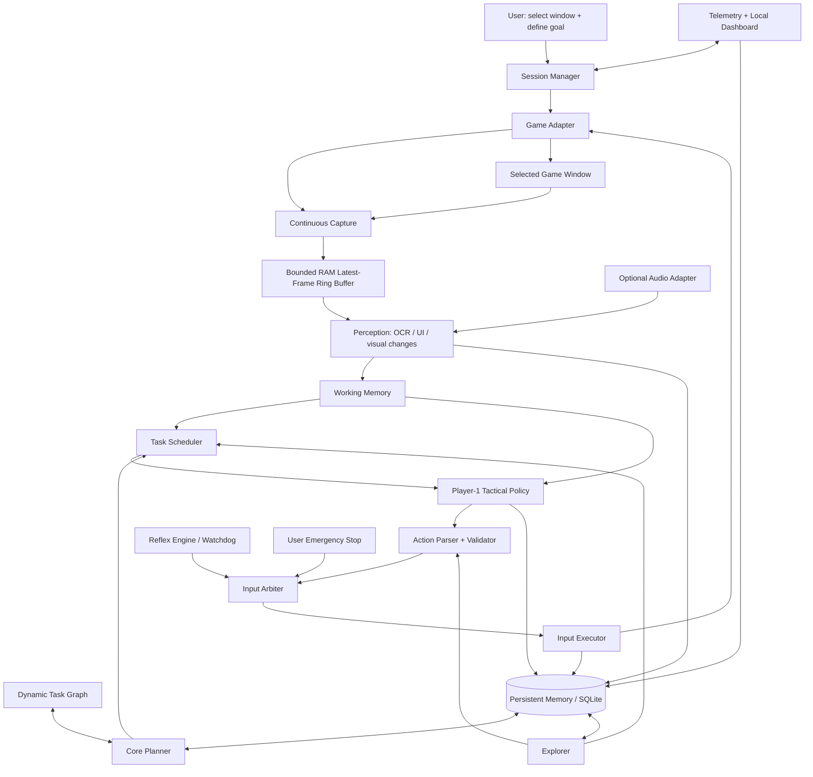

# Architecture and Runtime Data Flow

## 1. Architectural Goal

A general autonomous PC game agent that can operate on an unfamiliar game without title-specific code, preloaded walkthroughs, game APIs, or internal-state access.

The initial implementation uses a Windows client and a remote Player-1 inference service. The game-agnostic logic must remain independent of the selected game's title and implementation.

## 2. Component Diagram

Only the Input Arbiter can authorize operating-system input. Player-1, Planner, Explorer, and Reflex may submit proposals or cancellation requests; they cannot call the OS input API directly.

## 3. Component Responsibilities

### 3.1 Session Manager
- Owns session lifecycle: start, pause, resume, stop, and shutdown.
- Stores the selected-window identity.
- Holds the user-defined goal.
- Starts and supervises workers.
- Rejects stale responses from an earlier session or window.
- Ensures shutdown releases every held input.

### 3.2 Game Adapter
- Selects and captures the user-selected game window.
- Provides a stable window identifier for safe input routing.
- Checks focus and capture health.
- Exposes capture and input through interfaces.
- Does not inspect the game title to choose game-specific behavior.
- Initial implementation: DXcam/DXGI capture and Win32 `SendInput`.

### 3.3 Capture and Latest-Frame Buffer
- Captures continuously at a target of up to 30 FPS.
- Timestamps each frame.
- Stores frames in a fixed-capacity RAM ring buffer.
- Overwrites or discards old frames when full.
- Exposes the newest valid frame to Perception and Player-1.
- Never accumulates an unbounded screenshot queue.
- Does not write a continuous screenshot sequence to disk.

### 3.4 Perception Engine
- Performs lightweight screen-change and repeated-frame detection.
- Runs OCR on visible text, menus, prompts, and UI regions.
- Produces timestamped observations with confidence values.
- Processes the newest useful frame and skips stale frames.
- Does not infer hidden state that is not supported by visual/audio evidence.

### 3.5 Player-1 Tactical Policy
- Receives the latest prepared image, concise task instruction, and relevant short history.
- Uses the official Player-1 chat template and action format.
- Proposes short-horizon keyboard/mouse actions.
- Nominal action step: 200 ms; actual request throughput must be measured.
- Never receives direct OS input privileges.

### 3.6 Core Planner
- Converts user goals into subtasks, dependencies, priorities, and completion evidence.
- Starts with deterministic planning rules.
- May use a provider-neutral LLM adapter for complex planning.
- Runs on meaningful events, not every captured frame.
- Cannot issue direct input.

### 3.7 Explorer
- Discovers visible controls, menus, tutorials, and mechanics.
- Proposes short, bounded, low-risk experiments.
- Records hypotheses, preconditions, expected effects, observed effects, and confidence.
- Does not use title-specific scripts or hidden game information.

### 3.8 Memory and Skill Store
- SQLite WAL + FTS5 initially.
- Stores sessions, observations, actions, outcomes, hypotheses, confirmed facts, skills, and task state.
- Separates general skills from session/game-specific control knowledge.
- Tracks evidence, confidence, and last validation.
- Does not store every full-resolution frame by default.

### 3.9 Dynamic Task Graph and Scheduler
- Tracks task dependencies and states.
- Dispatches only ready tasks.
- Ensures exclusive control ownership.
- Sends completion/failure evidence back to Planner and Memory.

### 3.10 Reflex Engine
- Detects focus loss, timeouts, capture stalls, repeated-action loops, no-progress states, and critical resource failures.
- Can cancel an action, request input release, or enter safe idle.
- Does not wait for Player-1 or a Planner response.

### 3.11 Input Arbiter and Executor
- Arbiter is the single authorization point and single writer to the OS input API.
- Enforces priorities, action expiry, selected-window identity, and bounds.
- Executor tracks held keys/buttons and matching releases.
- All termination paths release held input.

### 3.12 Optional Audio Adapter
- Captures loopback audio only when enabled.
- Produces bounded, timestamped contextual events or transcription.
- Feeds Perception/Planner through an adapter.
- Does not imply native audio input support in Player-1.

### 3.13 Telemetry and Dashboard
- Localhost-only status and controls.
- Displays selected window, session state, current task, capture FPS, inference latency, buffer/queue occupancy, RAM/VRAM, and worker health.
- Provides pause, resume, stop, and emergency-stop controls.
- Exports session and soak-test reports.

## 4. Control Priority

1. Emergency stop.
2. Focus loss, watchdog, or safety block.
3. Reflex recovery.
4. Explicit user-approved control.
5. Player-1 action.
6. Explorer action.

The Planner never owns the input channel. Only one task may own normal game control at a time.

## 5. Runtime Scheduling

| Loop | Initial cadence | Work |
|---|---:|---|
| Capture | Up to 30 FPS | Capture and replace oldest frame in bounded RAM buffer |
| Perception | Up to 10–30 Hz | Process newest frame; skip stale frames |
| Input dispatch | Event-driven / 60 Hz scheduler tick | Execute validated action, expiry, and release |
| Player-1 | Request-driven | Propose short-horizon action; nominal 200 ms step |
| Planner | Event-driven | Replan on goal, discovery, blocker, or milestone |
| Explorer | Event-driven | Propose and evaluate bounded experiments |
| Reflex | Continuous / event-driven | Interrupt unsafe or stalled operation |
| Memory writer | Event-driven / batched | Persist observations and outcomes |
| Telemetry | Periodic / event-driven | Record health and resource metrics |

Capture at 30 FPS does not mean the model reasons at 30 FPS. Player-1's nominal 200 ms action step suggests approximately five decisions per second, but actual throughput depends on measured model and network latency.

## 6. End-to-End Data Flow

1. User selects a window and defines a goal.
2. Session Manager validates the selected window and starts workers.
3. Game Adapter captures a frame and timestamp.
4. Latest-Frame Buffer replaces its oldest frame if capacity is reached.
5. Perception extracts visible text, UI regions, and visual events.
6. Working Memory updates the current observation.
7. Scheduler selects one ready task or an exploration action.
8. Player-1 receives the current image, instruction, and relevant history when a tactical decision is needed.
9. Player-1 Adapter parses the official action format.
10. Validator checks the action schema, coordinates, keys, duration, session, and expiry.
11. Input Arbiter checks priority, focus, ownership, and safety state.
12. Executor dispatches the authorized action.
13. Subsequent frames provide evidence of the result.
14. Memory stores the observation, action, outcome, and confidence.
15. Planner/Explorer update task dependencies, hypotheses, and skills.
16. Reflex may interrupt any active step.

## 7. Failure Handling

| Failure | Required response |
|---|---|
| Player-1 endpoint unavailable | Enter safe idle; show endpoint error |
| Malformed action | Reject; log failure; do not execute |
| Model timeout | Cancel request; release held inputs |
| Focus lost | Block input immediately; release all held inputs |
| Game window closed | Cancel tasks and stop control |
| Capture stalled | Stop control; never reuse stale frames |
| Memory database unavailable | Stop autonomous control or enter explicit degraded mode; never silently lose evidence |
| Conflicting task ownership | Reject second owner |
| Repeated experiment failure | Mark blocked and request replanning |
| Queue reaches capacity | Drop stale frame work or apply documented backpressure; never grow without bound |
| Critical RAM/VRAM pressure | Stop new work safely, release inputs, and report resource fault |
| Worker crash | Cancel dependent work, release inputs, restart only under bounded policy |

## 8. Memory and Long-Run Resource Management

- Frame buffers, task queues, inference queues, and caches must have explicit capacity limits.
- Capture frames remain in RAM and are overwritten/discarded; no continuous screenshot series is written to disk by default.
- Workers must support cancellation and deterministic cleanup.
- Memory writes are batched where appropriate.
- Persistent records use configurable retention/export policies.
- Telemetry records RAM, VRAM, queue lengths, buffer occupancy, database growth, and worker health.
- An 8–12 hour soak test must demonstrate stable resource usage and no accumulating backlog.

## 9. Observability

Record:
- Capture FPS, frame age, and dropped-frame count.
- Perception latency and OCR confidence.
- Player-1 request p50/p95 latency, timeout rate, and error rate.
- Image upload and network latency.
- Action duration and input dispatch latency.
- Invalid/expired action counts.
- Task success/failure and experiment outcomes.
- Current held-input state.
- RAM, VRAM, queue lengths, buffer occupancy, and database size.
- Worker restarts and recovery events.

Do not log credentials or raw API keys. Full-resolution screenshots are opt-in evidence artifacts only, with explicit retention controls.

## 10. Deployment Layout

**Local Windows application:** Session Manager, Game Adapter, capture ring buffer, Perception, Planner orchestration, Explorer, Memory, Task Graph/Scheduler, Input Arbiter, Executor, Reflex Engine, optional Audio Adapter, Dashboard, and Telemetry.

**Remote inference service:** official Player-1 model, official Player-1 chat template, and authenticated OpenAI-compatible endpoint.

The game remains on the local machine. The remote service receives only the image and minimal task/history context required for inference. The game title is not required by the remote policy.
